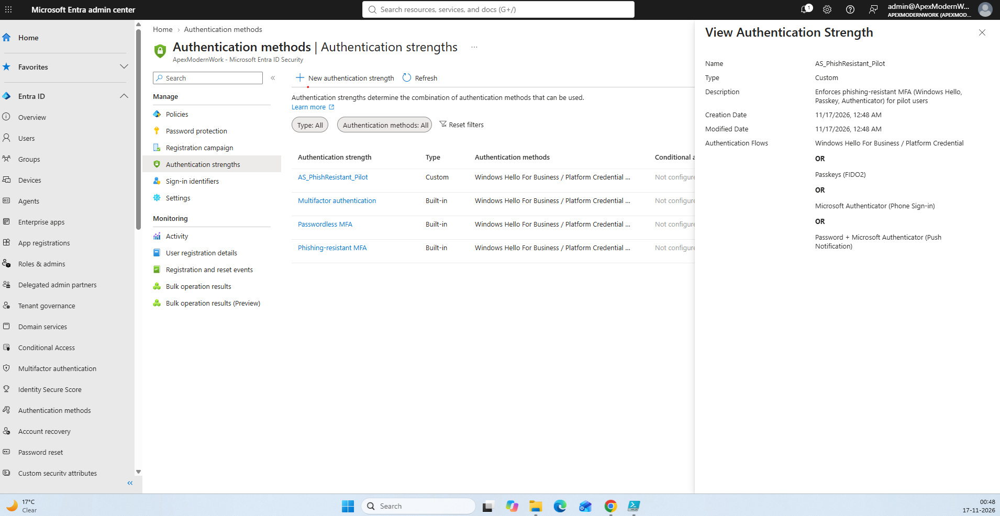
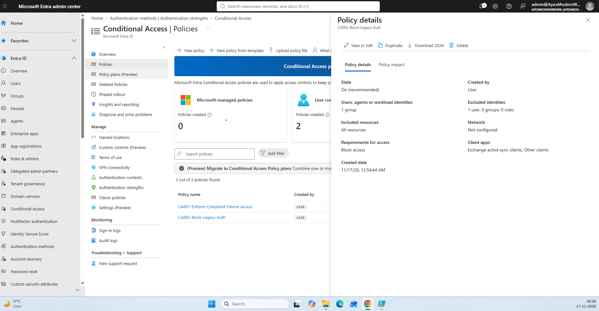
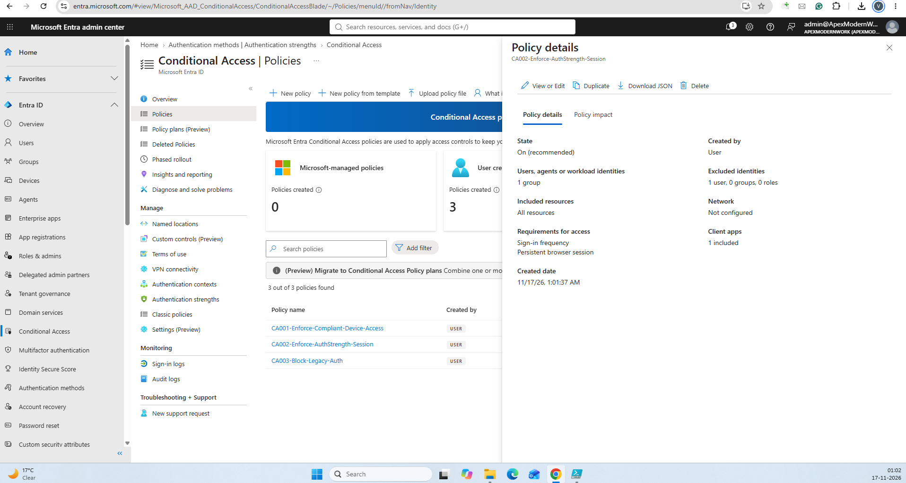
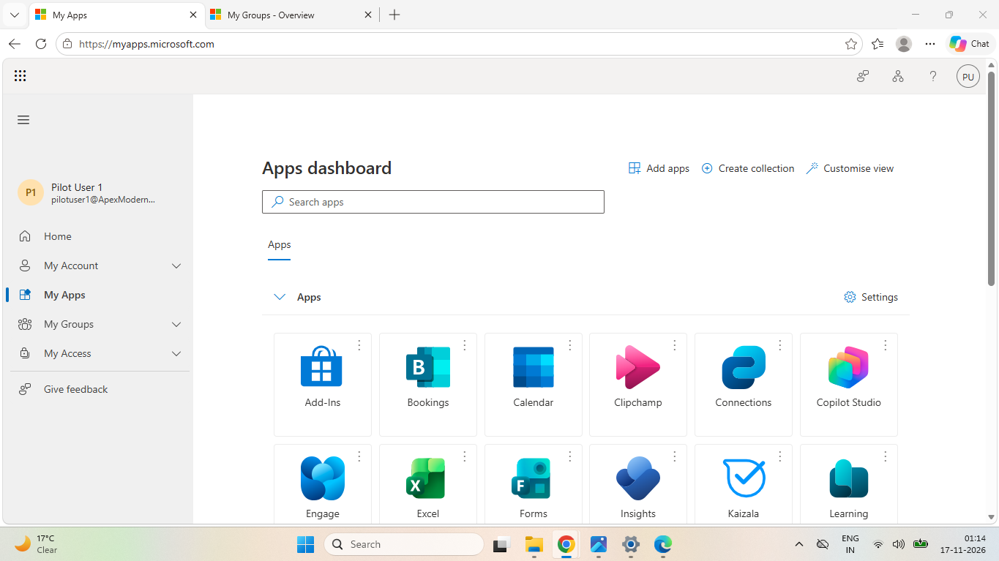
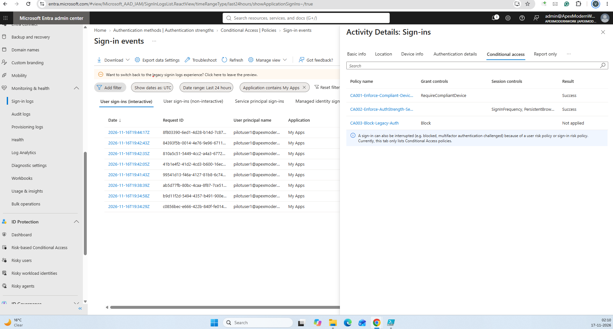
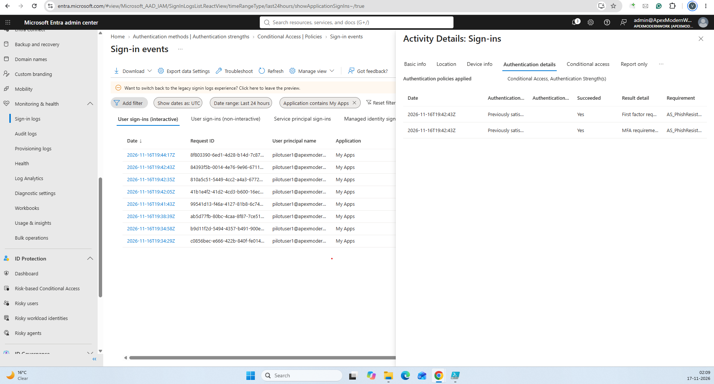

cd "C:\Users\Administrator\Desktop\Enterprise-Entra-AuthStrength-Session-Lab"

@'
# Microsoft Entra ID Phishing-Resistant MFA, Authentication Strengths & Session Governance Lab

Enterprise identity defense, phishing-resistant authentication governance, and session lifetime enforcement lab built on **Microsoft Entra ID** and **Windows 11 Pro** (`TESTUSER-1`) within the `ApexModernWork.onmicrosoft.com` tenant.

## Architecture Overview

This lab hardens cloud authentication and browser session lifetimes beyond basic MFA:

1. **Custom Authentication Strength (`AS_PhishResistant_Pilot`):** Restricted high-assurance pilot sign-ins to phishing-resistant and modern passwordless/push methods (**Windows Hello for Business**, **Passkeys (FIDO2)**, **Microsoft Authenticator Phone Sign-in**, and **Microsoft Authenticator Push Notification**), eliminating weak SMS/Voice OTP fallback methods.
2. **Legacy Authentication Block (`CA003-Block-Legacy-Auth`):** Blocked legacy Basic Authentication protocols (**Exchange ActiveSync clients** and **Other clients** such as legacy IMAP/POP3/SMTP) across all cloud applications for `SG-M365-Pilot-Devices-Users`.
3. **Authentication Strength & Session Lifetime Enforcement (`CA002-Enforce-AuthStrength-Session`):** Enforced `AS_PhishResistant_Pilot` alongside strict session token controls (**Sign-in frequency: 4 hours** periodic reauthentication and **Persistent browser session: Never persistent**).
4. **End-to-End Telemetry & Audit Verification:** Validated multi-policy Conditional Access evaluation (`CA001` device compliance + `CA002` authentication strength & session controls) via live `pilotuser1@ApexModernWork.onmicrosoft.com` sign-in testing and Entra ID Sign-In Logs.

---

## Lab Evidence & Artifacts

### 01. Custom Authentication Strength Configuration

* **#01 Custom Authentication Strength (`AS_PhishResistant_Pilot`):** Configured custom authentication strength permitting Windows Hello for Business, Passkeys (FIDO2), and Microsoft Authenticator while excluding legacy SMS/Voice OTPs.

---

### 02. Conditional Access Policies (`CA003` & `CA002`)

* **#02 Legacy Authentication Block (`CA003-Block-Legacy-Auth`):** Scoped to `SG-M365-Pilot-Devices-Users` (excluding break-glass admin), blocking `Exchange ActiveSync clients` and `Other clients` across all cloud apps.

* **#03 Authentication Strength & Session Policy (`CA002-Enforce-AuthStrength-Session`):** Enforced `AS_PhishResistant_Pilot` with `4 hours` sign-in frequency and `Never persistent` browser sessions.

---

### 03. Live Enforcement & Entra ID Sign-In Logs

* **#04 Live Pilot User Verification (`pilotuser1`):** Validated compliant endpoint access on `TESTUSER-1` via Microsoft Edge to `myapps.microsoft.com` with persistent browser cookies suppressed.

* **#05 Sign-In Log — Conditional Access Evaluation:** Audited `pilotuser1` interactive sign-in confirming `CA001-Enforce-Compliant-Device` (`Success`), `CA002-Enforce-AuthStrength-Session` (`SignInFrequency, PersistentBrowserSession` -> `Success`), and `CA003-Block-Legacy-Auth` (`Not applied`).

* **#06 Sign-In Log — Authentication Strength & MFA Details:** Verified `Authentication policies applied: Conditional Access, Authentication Strength(s)` satisfying `AS_PhishResistant_Pilot` (`Succeeded: Yes`).

'@ | Set-Content -Path .\README.md -Encoding UTF8

Get-ChildItem -Recurse -File | Resolve-Path -Relative
